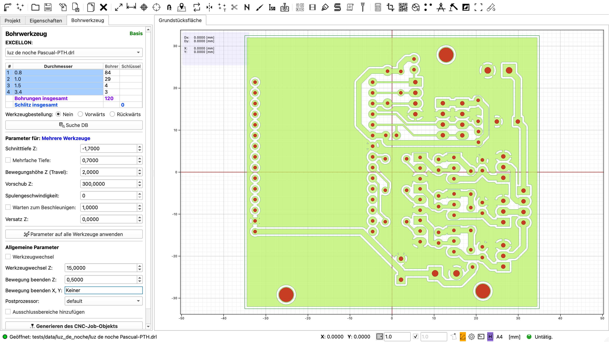

<p align="right"><a href="README.md">🇪🇸 Español</a> · <a href="README.en.md">🇬🇧 English</a> · <a href="README.de.md">🇩🇪 Deutsch</a> · <a href="README.fr.md">🇫🇷 Français</a> · <a href="README.it.md">🇮🇹 Italiano</a> · <a href="README.pt-BR.md">🇧🇷 Português</a> · <a href="README.ro.md">🇷🇴 Română</a> · <a href="README.ru.md">🇷🇺 Русский</a> · <a href="README.tr.md">🇹🇷 Türkçe</a></p>

<p align="center">
  
</p>

<h1 align="center">FlatCAM-cpp</h1>

<p align="center">
  Port nativo di <strong>FlatCAM 2024.4</strong> in C++17, Qt 6 e GEOS per realizzare circuiti stampati con una CNC o un laser.
</p>

<p align="center">
  <a href="https://github.com/dnasta/flatcam-cpp/releases/latest"></a>
  <a href="LICENSE"></a>
  <a href="https://github.com/dnasta/flatcam-cpp/actions/workflows/ci.yml"></a>
  
  
  
  
  
</p>

<p align="center">
  <a href="https://github.com/dnasta/flatcam-cpp/releases/latest"><strong>⬇ Scarica la v1.0.0</strong></a> ·
  <a href="docs/NOTAS_1.0.0.md"><strong>📝 Note di rilascio (spagnolo)</strong></a> ·
  <a href="https://github.com/dnasta/flatcam-cpp/issues"><strong>🐞 Segnala un problema</strong></a>
</p>

---

## Indice

- [Cos’è FlatCAM-cpp](#cosè-flatcam-cpp)
- [Schermate](#schermate)
- [Funzionalità](#funzionalità)
- [Lingue](#lingue)
- [Formati supportati](#formati-supportati)
- [Installazione](#installazione)
- [Avvio rapido](#avvio-rapido)
- [Riga di comando e automazione](#riga-di-comando-e-automazione)
- [Compilare dai sorgenti](#compilare-dai-sorgenti)
- [Test e verifica](#test-e-verifica)
- [Struttura del progetto](#struttura-del-progetto)
- [Licenza, autori e riconoscimenti](#licenza-autori-e-riconoscimenti)

---

## Cos’è FlatCAM-cpp

FlatCAM trasforma i file di progetto di un circuito stampato —strati **Gerber** e forature **Excellon**— in **G-code** per una fresatrice CNC, un router o un laser: isolamento delle piste, rimozione del rame, foratura, taglio della scheda e molto altro.

FlatCAM-cpp è un port **completo** di FlatCAM 2024.4 (Python + PyQt5) in **C++17**, con **Qt 6** per l’interfaccia e **GEOS** per la geometria. L’interfaccia è quella dell’originale —è stata generata dalla vera interfaccia originale—, con gli stessi menu, pannelli, scorciatoie e preferenze, e legge e scrive gli stessi progetti `.FlatPrj`.

**In una frase:** apri la scheda, scegli l’utensile, controlli i percorsi e salvi il G-code.

### Perché un port nativo

| Aspetto | FlatCAM 2024.4 (Python) | FlatCAM-cpp |
|---|---|---|
| Esecuzione | Python 3 + PyQt5 + Shapely + numpy + vispy | Eseguibile nativo |
| Installazione | Installare Python e le sue dipendenze | Installer per macOS, Windows e Linux |
| Geometria | Shapely | GEOS (API C rientrante) |
| Interfaccia | Qt 5 | Qt 6 con area di disegno OpenGL |
| Velocità (rimozione del rame di una scheda reale) | 567 s | 56 s |
| Bug noti dell’originale | Presenti | Oltre 200 corretti (`--original-bugs` ripristina il comportamento originale) |

---

## Schermate

<p align="center">
  
  <br><em>Finestra principale: il rame di una scheda reale con le sue proprietà (interfaccia in spagnolo).</em>
</p>

<p align="center">
  
  <br><em>Strumento di rimozione del rame (NCC).</em>
</p>

<p align="center">
  
  <br><em>G-code della rimozione del rame, della foratura e del taglio (spostamenti in giallo).</em>
</p>

<p align="center">
  
  <br><em>La stessa interfaccia in tedesco, con lo strumento di foratura.</em>
</p>

---

## Funzionalità

### File

- **Gerber RS-274X**: aperture C/R/O/P, macro `%AM`, regioni `G36/G37`, archi `G02/G03`, polarità e attributi X2.
- **Excellon**: utensili, fori, asole (`G85` e routing), formati e zeri, file senza intestazione.
- **G-code**: aprire, visualizzare, modificare ed esportare.
- **SVG, DXF, PDF, HPGL2 e immagini** (PNG, JPG, BMP), come Geometria o come Gerber.
- **Progetti `.FlatPrj`** del FlatCAM in Python (compressi LZMA, anche di centinaia di MB); il FlatCAM originale apre quelli salvati dal port.
- **Esportare** in Gerber, Excellon, SVG, DXF, PNG e PDF.

### Strumenti CAM

- **Isolamento**: passate, sovrapposizione, frese a V, combinato, lavorazione del residuo, per area o per poligono.
- **Rimozione del rame (NCC)** e **Pittura (Paint)**: metodi Standard, Seme, Linee e Combo, lavorazione del residuo, area e oggetto di riferimento; «linee laser».
- **Foratura**: ordine ottimizzato, profondità multipla, asole come fori; fresatura di fori e asole.
- **Taglio del contorno**: libero o rettangolare, ponticelli, «mouse bites» e ponticelli manuali.
- **PCB a due facce**: specchiatura per punto, riquadro o foro, e fori di allineamento.
- **E inoltre**: Pannellizzazione, Film, Riempimento di rame (thieving), Pasta saldante, Codice QR, Fiducial, Marcatori d’angolo, Estrai fori, Punzona Gerber, Sottrai, Ottimale, Verifica regole, Calibrazione, Compensazione dell’incisione, Allinea oggetti, Inverti Gerber, Calcolatrici, Trasformazioni, Distanza e Livellamento automatico (tastatura con GRBL, MACH3/4 e LinuxCNC).
- **Database degli utensili** e **aree di esclusione**.

### G-code

- I **20 postprocessori** dell’originale (`default`, `GRBL_laser`, `grbl_11`, `Marlin`, `Repetier`, `Roland_MDX_20`, `hpgl`, `ISEL_CNC`, `Toolchange_*`, `Z_laser`…), identici riga per riga.
- Profondità multipla, taglio extra, codice di inizio e di fine, millimetri o pollici.

### Editor

- **Geometria** (con testi scritti nei font di sistema), **Excellon**, **Gerber** e **G-code**.

### Interfaccia

- Quella di FlatCAM 2024.4: menu, barre degli strumenti, schede Progetto / Proprietà / Strumento e le stesse scorciatoie.
- Area di disegno OpenGL con zoom, panoramica, griglia, aggancio alla griglia, HUD e area di lavoro.
- Preferenze (485 opzioni), livelli Base e Avanzato, millimetri o pollici, file recenti e segnalibri.

### Automazione

- **Console Tcl** con il vero interprete Tcl e i **65 comandi** dell’originale; script `.tcl`.

---

## Lingue

L’interfaccia è disponibile nelle **9 lingue** dell’originale, con le stesse traduzioni: tedesco, inglese, spagnolo, francese, italiano, portoghese brasiliano, rumeno, russo e turco.

- Si avvia nella **lingua del sistema** (in inglese se non è tra le nove).
- Per cambiarla: **Preferenze → Generale →** scegliere la lingua **→ Applica lingua** (l’applicazione si riavvia).
- Per imporne una all’avvio: variabile d’ambiente `FLATCAM_LANGUAGE` (per esempio `FLATCAM_LANGUAGE=it`).

---

## Formati supportati

| Formato | Aprire / importare | Esportare | Note |
|---|:---:|:---:|---|
| Gerber RS-274X | ✅ | ✅ | Aperture, macro, regioni, polarità |
| Excellon | ✅ | ✅ | Fori e asole |
| G-code | ✅ | ✅ | 20 postprocessori |
| SVG | ✅ | ✅ | Come Geometria o Gerber |
| DXF | ✅ | ✅ | DXF ASCII |
| PDF | ✅ | ✅ | Importazione vettoriale; stampa e film |
| HPGL2 | ✅ | — | Il postprocessore `hpgl` genera codice per plotter |
| PNG / JPG / BMP | ✅ | ✅ | Vettorializzazione a soglia; istantanea dell’area di disegno e film |
| `.FlatPrj` | ✅ | ✅ | Compatibili con il FlatCAM in Python |

---

## Installazione

Gli installer si trovano nella pagina [**Releases**](https://github.com/dnasta/flatcam-cpp/releases/latest).

### macOS

- **macOS 15 o successivo**, con **Apple Silicon** (da M1 a M4).
- Apri `FlatCAM-1.0.0-macOS-arm64.dmg` e trascina **FlatCAM** in *Applicazioni*.
- La prima volta: clic destro → **Apri** (firma ad hoc, non notarizzata).
- Qt, GEOS, FreeType e Tcl sono inclusi: Homebrew non serve.

### Windows

- **Windows 10 (1809 o successivo) e Windows 11**, a 64 bit.
- `FlatCAM-1.0.0-Windows-x64-setup.exe` (installer) o `FlatCAM-1.0.0-Windows-x64.zip` (portatile, senza installazione).
- Se compare «Windows ha protetto il PC»: **Ulteriori informazioni → Esegui comunque** (non è firmato con un certificato).

### Linux

| Distribuzione | File | Installare |
|---|---|---|
| Ubuntu 24.04+, Debian 13, Linux Mint 22 | `flatcam-cpp_1.0.0_amd64.deb` | `sudo apt install ./flatcam-cpp_1.0.0_amd64.deb` |
| Fedora 41+ | `flatcam-cpp-1.0.0-1.x86_64.rpm` | `sudo dnf install ./flatcam-cpp-1.0.0-1.x86_64.rpm` |
| Altre (glibc 2.39+) | `FlatCAM-1.0.0-Linux-x86_64.AppImage` | `chmod +x FlatCAM-*.AppImage && ./FlatCAM-*.AppImage` |

Con il `.deb` o il `.rpm`, FlatCAM compare nel menu delle applicazioni e si avvia con il comando `flatcam`.

---

## Avvio rapido

```text
1. File → Apri → Apri Gerber      rame e contorno della scheda
   File → Apri → Apri Excellon    fori
2. Seleziona il rame in Progetto → Proprietà → Percorso di isolamento (o Strumento NCC)
   diametro della fresa, passate e sovrapposizione → Genera geometria
3. Nella nuova Geometria: Proprietà → Z di taglio, avanzamento → Genera oggetto CNCJob
4. Nel CNC Job: Calva codice CNC
5. Fori: Tool Foratura → Genera oggetto CNCJob
6. Contorno: Strumento Ritaglia → ponticelli → Genera geometria
```

> **Prima di lavorare:** controlla il G-code, lo zero pezzo e l’altezza Z. Un errore di 0,1 mm può rovinare la scheda.

---

## Riga di comando e automazione

```bash
FlatCAM scheda-B_Cu.gbr scheda-Edge_Cuts.gbr scheda.drl   # apre i file (secondo l’estensione)
FlatCAM progetto.FlatPrj                                   # apre un progetto
FlatCAM script.tcl                                         # apre ed esegue uno script Tcl
FlatCAM --original-bugs                                    # si comporta esattamente come il FlatCAM originale
```

L’eseguibile è `FlatCAM` (su macOS, `/Applications/FlatCAM.app/Contents/MacOS/FlatCAM`), `FlatCAM.exe` su Windows e `flatcam` su Linux.

### Console Tcl

Si apre con **Riga di comando** (tasto `S`). Esempio:

```tcl
open_gerber scheda-B_Cu.gbr -outname rame
isolate rame -dia 0.2 -passes 2 -overlap 10 -combine True -outname rame_iso
cncjob rame_iso -dia 0.2 -z_cut -0.1 -z_move 2 -feedrate 120 -pp default -outname rame_cnc
write_gcode rame_cnc rame.nc

open_excellon scheda.drl -outname fori
drillcncjob fori -drillz -1.8 -travelz 2 -feedrate_z 100 -pp default -outname fori_cnc
write_gcode fori_cnc fori.nc
```

`help` elenca i 65 comandi e `help <comando>` spiega ciascuno.

---

## Compilare dai sorgenti

| Dipendenza | Uso |
|---|---|
| Compilatore C++17 e CMake 3.20+ | AppleClang, GCC o MSVC 2022 |
| GEOS 3.11+ | Geometria |
| Qt 6.4+ | Interfaccia (Widgets, OpenGLWidgets, Svg, PrintSupport; SerialPort opzionale) |
| Tcl 8.6 o 9 | Console Tcl |
| liblzma | Progetti `.FlatPrj` compressi |
| FreeType (opzionale) | Testi con font nell’editor di Geometria |
| GoogleTest | Test (CMake lo scarica se manca) |

**macOS (Homebrew)**

```zsh
brew install cmake ninja geos qt tcl-tk freetype xz googletest
cmake -S . -B build -G Ninja
cmake --build build
ctest --test-dir build --output-on-failure
open build/src/gui/FlatCAM.app
tools/package_macos.sh            # build/dist/FlatCAM-1.0.0-macOS-arm64.dmg
```

**Linux (Ubuntu / Debian)**

```bash
sudo apt install build-essential cmake ninja-build libgeos-dev liblzma-dev libgtest-dev \
  qt6-base-dev qt6-svg-dev qt6-serialport-dev libgl-dev tcl-dev libfreetype-dev
cmake -S . -B build -G Ninja -DCMAKE_BUILD_TYPE=Release
cmake --build build
ctest --test-dir build --output-on-failure
tools/package_linux.sh            # .deb e AppImage (su Fedora: .rpm)
```

**Windows (Visual Studio 2022 + vcpkg + Qt)**

```bat
vcpkg install geos liblzma freetype gtest tcl --triplet x64-windows
cmake -S . -B build -G Ninja -DCMAKE_BUILD_TYPE=Release -DCMAKE_TOOLCHAIN_FILE=%VCPKG_ROOT%\scripts\buildsystems\vcpkg.cmake
cmake --build build
ctest --test-dir build --output-on-failure
pwsh tools/package_windows.ps1    # installer (Inno Setup) e .zip
```

Opzioni di CMake: `-DFLATCAM_BUILD_TESTS=OFF`, `-DFLATCAM_BUILD_DOCS=OFF`, `-DFLATCAM_BUILD_GUI=OFF` (solo il nucleo).

**Documentazione del codice** (Doxygen, in spagnolo): `cmake --build build --target docs` → `build/doxygen/html/index.html`.

---

## Test e verifica

- **2.854 test** (GoogleTest): nucleo e interfaccia. Girano nella CI (GitHub Actions) su Linux e Windows, e con due versioni di GEOS.
- I valori attesi **non sono stati scritti a mano**: gli oracoli di `tests/tools/` eseguono il codice **originale** di FlatCAM (parser, strumenti, postprocessori, editor, console Tcl e l’interfaccia PyQt5) e ne salvano i risultati.
- Contro l’**eseguibile FlatCAM 2024.4** con una scheda reale: il taglio risulta **identico byte per byte**, Paint e NCC con gli stessi percorsi e la foratura con gli stessi fori.
- I bug dell’originale sono corretti nell’applicazione; i test li riattivano per continuare il confronto con l’originale, e ogni correzione ha il suo test.

---

## Struttura del progetto

```text
src/core/        Nucleo senza Qt: forme (GEOS), geometria, archi, trasformazioni
src/parsers/     Gerber, Excellon, SVG, DXF, PDF, HPGL2, immagini e font
src/tools/       Strumenti CAM (isolamento, NCC, Paint, taglio, due facce, pannellizzazione, film...)
src/cam/         G-code, postprocessori, ordine dei fori, livellamento
src/editors/     Modelli degli editor (senza Qt)
src/io/          Progetti .FlatPrj ed esportazione
src/gui/         Interfaccia Qt 6 (generated/: generata dall’interfaccia originale)
tests/           GoogleTest, dati reali e oracoli in Python
tools/           Generatori dell’interfaccia, delle traduzioni e dei pacchetti
reference/       Sorgenti di FlatCAM 2024.4 (sola lettura)
```

---

## Licenza, autori e riconoscimenti

FlatCAM-cpp è distribuito con **licenza MIT**, come FlatCAM. Vedi [`LICENSE`](LICENSE) e [`NOTICE`](NOTICE).

È il port di una catena di versioni di FlatCAM:

1. **FlatCAM**, creato da **Juan Pablo Caram** (2014–2016). <http://flatcam.org>
2. **FlatCAM Beta** (8.9xx e 2024.x), di **Marius Adrian Stanciu** e collaboratori (2019–2024).
3. **FlatCAM β 2024.4**, mantenuto da **vika-sonne** (2023–2024).
4. **FlatCAM-cpp**: il port in C++17 con Qt 6 e GEOS.

**Riconoscimenti:** gli autori di FlatCAM e i suoi traduttori; [GEOS](https://libgeos.org) (OSGeo); [Qt](https://www.qt.io) (The Qt Company); [Tcl](https://www.tcl-lang.org); [FreeType](https://freetype.org); la libreria [qrcode](https://github.com/lincolnloop/python-qrcode) di Lincoln Loop (portata in C++).

<p align="center"><sub>C++17 · Qt 6 · GEOS · macOS · Windows · Linux · v1.0.0</sub></p>
