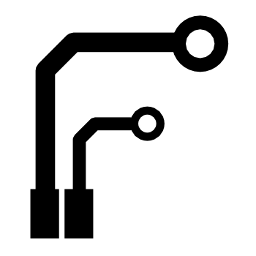

<p align="right"><a href="README.md">🇪🇸 Español</a> · <a href="README.en.md">🇬🇧 English</a> · <a href="README.de.md">🇩🇪 Deutsch</a> · <a href="README.fr.md">🇫🇷 Français</a> · <a href="README.it.md">🇮🇹 Italiano</a> · <a href="README.pt-BR.md">🇧🇷 Português</a> · <a href="README.ro.md">🇷🇴 Română</a> · <a href="README.ru.md">🇷🇺 Русский</a> · <a href="README.tr.md">🇹🇷 Türkçe</a></p>

<p align="center">
  
</p>

<h1 align="center">FlatCAM-cpp</h1>

<p align="center">
  Port nativo do <strong>FlatCAM 2024.4</strong> para C++17, Qt 6 e GEOS, para fabricar placas de circuito impresso com uma CNC ou um laser.
</p>

<p align="center">
  <a href="https://github.com/dnasta/flatcam-cpp/releases/latest"></a>
  <a href="LICENSE"></a>
  <a href="https://github.com/dnasta/flatcam-cpp/actions/workflows/ci.yml"></a>
  
  
  
  
  
</p>

<p align="center">
  <a href="https://github.com/dnasta/flatcam-cpp/releases/latest"><strong>⬇ Baixar a v1.0.0</strong></a> ·
  <a href="docs/NOTAS_1.0.0.md"><strong>📝 Notas da versão (espanhol)</strong></a> ·
  <a href="https://github.com/dnasta/flatcam-cpp/issues"><strong>🐞 Relatar um problema</strong></a>
</p>

---

## Índice

- [O que é o FlatCAM-cpp](#o-que-é-o-flatcam-cpp)
- [Capturas de tela](#capturas-de-tela)
- [Recursos](#recursos)
- [Idiomas](#idiomas)
- [Formatos suportados](#formatos-suportados)
- [Instalação](#instalação)
- [Início rápido](#início-rápido)
- [Linha de comando e automação](#linha-de-comando-e-automação)
- [Compilar a partir do código-fonte](#compilar-a-partir-do-código-fonte)
- [Testes e verificação](#testes-e-verificação)
- [Estrutura do projeto](#estrutura-do-projeto)
- [Licença, autoria e créditos](#licença-autoria-e-créditos)

---

## O que é o FlatCAM-cpp

O FlatCAM converte os arquivos de projeto de uma PCB —camadas **Gerber** e furações **Excellon**— em **G-code** para uma fresadora CNC, um router ou um laser: isolação de trilhas, remoção de cobre, furação, recorte da placa e muito mais.

O FlatCAM-cpp é um port **completo** do FlatCAM 2024.4 (Python + PyQt5) para **C++17**, com **Qt 6** na interface e **GEOS** na geometria. A interface é a do original —foi gerada a partir da interface original real—, com os mesmos menus, painéis, atalhos e preferências, e lê e grava os mesmos projetos `.FlatPrj`.

**Em uma frase:** você abre a placa, escolhe a ferramenta, confere os percursos e salva o G-code.

### Por que um port nativo

| Aspecto | FlatCAM 2024.4 (Python) | FlatCAM-cpp |
|---|---|---|
| Execução | Python 3 + PyQt5 + Shapely + numpy + vispy | Executável nativo |
| Instalação | Instalar o Python e suas dependências | Instaladores para macOS, Windows e Linux |
| Geometria | Shapely | GEOS (API C reentrante) |
| Interface | Qt 5 | Qt 6 com área de desenho OpenGL |
| Velocidade (remoção de cobre de uma placa real) | 567 s | 56 s |
| Erros conhecidos do original | Presentes | Mais de 200 corrigidos (`--original-bugs` restaura o comportamento original) |

---

## Capturas de tela

<p align="center">
  
  <br><em>Janela principal: o cobre de uma placa real com suas propriedades (interface em espanhol).</em>
</p>

<p align="center">
  
  <br><em>Ferramenta de remoção de cobre (NCC).</em>
</p>

<p align="center">
  
  <br><em>G-code da remoção de cobre, da furação e do recorte (deslocamentos em amarelo).</em>
</p>

<p align="center">
  
  <br><em>A mesma interface em alemão, com a ferramenta de furação.</em>
</p>

---

## Recursos

### Arquivos

- **Gerber RS-274X**: aberturas C/R/O/P, macros `%AM`, regiões `G36/G37`, arcos `G02/G03`, polaridade e atributos X2.
- **Excellon**: ferramentas, furos, rasgos (`G85` e roteamento), formatos e zeros, arquivos sem cabeçalho.
- **G-code**: abrir, visualizar, editar e exportar.
- **SVG, DXF, PDF, HPGL2 e imagens** (PNG, JPG, BMP), como Geometria ou como Gerber.
- **Projetos `.FlatPrj`** do FlatCAM em Python (compactados com LZMA, mesmo com centenas de MB); o FlatCAM original abre os que o port salva.
- **Exportar** Gerber, Excellon, SVG, DXF, PNG e PDF.

### Ferramentas CAM

- **Isolação**: passadas, sobreposição, fresas em V, combinada, usinagem de resto, por área ou por polígono.
- **Remoção de cobre (NCC)** e **Pintura (Paint)**: métodos Padrão, Semente, Linhas e Combo, usinagem de resto, área e objeto de referência; "linhas laser".
- **Furação**: ordem otimizada, profundidade múltipla, rasgos como furos; fresagem de furos e rasgos.
- **Recorte**: livre ou retangular, pontes, "mouse bites" e pontes manuais.
- **PCB de 2 faces**: espelhamento por ponto, caixa ou furo, e furos de alinhamento.
- **E ainda**: Panelizar, Filme, Preenchimento de cobre (thieving), Pasta de solda, Código QR, Fiduciais, Marcas de canto, Extrair furos, Perfurar Gerber, Subtrair, Ótimo, Verificação de regras, Calibração, Compensação de corrosão, Alinhar objetos, Inverter Gerber, Calculadoras, Transformações, Distância e Nivelamento automático (sondagem com GRBL, MACH3/4 e LinuxCNC).
- **Banco de dados de ferramentas** e **áreas de exclusão**.

### G-code

- Os **20 pós-processadores** do original (`default`, `GRBL_laser`, `grbl_11`, `Marlin`, `Repetier`, `Roland_MDX_20`, `hpgl`, `ISEL_CNC`, `Toolchange_*`, `Z_laser`…), idênticos linha por linha.
- Profundidade múltipla, corte extra, trechos de código de início e de fim, milímetros ou polegadas.

### Editores

- **Geometria** (com textos escritos nas fontes do sistema), **Excellon**, **Gerber** e **G-code**.

### Interface

- A do FlatCAM 2024.4: menus, barras de ferramentas, abas Projeto / Propriedades / Ferramenta e os mesmos atalhos.
- Área de desenho OpenGL com zoom, deslocamento, grade, encaixe na grade, HUD e área de trabalho.
- Preferências (485 opções), níveis Básico e Avançado, milímetros ou polegadas, arquivos recentes e favoritos.

### Automação

- **Console Tcl** com o interpretador Tcl real e os **65 comandos** do original; scripts `.tcl`.

---

## Idiomas

A interface está nos **9 idiomas** do original, com as mesmas traduções: alemão, inglês, espanhol, francês, italiano, português do Brasil, romeno, russo e turco.

- Ela abre no **idioma do sistema** (em inglês, se ele não estiver entre os nove).
- Para trocar: **Preferências → Geral →** escolher o idioma **→ Aplicar o Idioma** (o aplicativo reinicia).
- Para forçar um idioma ao iniciar: variável de ambiente `FLATCAM_LANGUAGE` (por exemplo `FLATCAM_LANGUAGE=pt_BR`).

---

## Formatos suportados

| Formato | Abrir / importar | Exportar | Observações |
|---|:---:|:---:|---|
| Gerber RS-274X | ✅ | ✅ | Aberturas, macros, regiões, polaridade |
| Excellon | ✅ | ✅ | Furos e rasgos |
| G-code | ✅ | ✅ | 20 pós-processadores |
| SVG | ✅ | ✅ | Como Geometria ou Gerber |
| DXF | ✅ | ✅ | DXF ASCII |
| PDF | ✅ | ✅ | Importação vetorial; impressão e filme |
| HPGL2 | ✅ | — | O pós-processador `hpgl` gera código para plotters |
| PNG / JPG / BMP | ✅ | ✅ | Vetorização por limiar; captura da área de desenho e filme |
| `.FlatPrj` | ✅ | ✅ | Compatíveis com o FlatCAM em Python |

---

## Instalação

Os instaladores estão na página de [**Releases**](https://github.com/dnasta/flatcam-cpp/releases/latest).

### macOS

- **macOS 15 ou posterior**, com **Apple Silicon** (M1 a M4).
- Abra `FlatCAM-1.0.0-macOS-arm64.dmg` e arraste o **FlatCAM** para *Aplicativos*.
- Na primeira vez: clique com o botão direito → **Abrir** (assinatura ad hoc, não autenticada pela Apple).
- Inclui Qt, GEOS, FreeType e Tcl: não precisa do Homebrew.

### Windows

- **Windows 10 (1809 ou posterior) e Windows 11**, de 64 bits.
- `FlatCAM-1.0.0-Windows-x64-setup.exe` (instalador) ou `FlatCAM-1.0.0-Windows-x64.zip` (portátil, sem instalar).
- Se aparecer "O Windows protegeu o computador": **Mais informações → Executar assim mesmo** (não é assinado com certificado).

### Linux

| Distribuição | Arquivo | Instalar |
|---|---|---|
| Ubuntu 24.04+, Debian 13, Linux Mint 22 | `flatcam-cpp_1.0.0_amd64.deb` | `sudo apt install ./flatcam-cpp_1.0.0_amd64.deb` |
| Fedora 41+ | `flatcam-cpp-1.0.0-1.x86_64.rpm` | `sudo dnf install ./flatcam-cpp-1.0.0-1.x86_64.rpm` |
| Outras (glibc 2.39+) | `FlatCAM-1.0.0-Linux-x86_64.AppImage` | `chmod +x FlatCAM-*.AppImage && ./FlatCAM-*.AppImage` |

Com o `.deb` ou o `.rpm`, o FlatCAM aparece no menu de aplicativos e abre com o comando `flatcam`.

---

## Início rápido

```text
1. Arquivo → Abrir → Abrir Gerber      cobre e contorno da placa
   Arquivo → Abrir → Abrir Excellon    furos
2. Selecione o cobre em Projeto → Propriedades → Roteamento de Isolação (ou Ferramenta NCC)
   diâmetro da fresa, passadas e sobreposição → Gerar Geometria
3. Na nova Geometria: Propriedades → Z de corte, avanço → Gera o objeto de Trabalho CNC
4. No CNC Job: Salvar Código CNC
5. Furos: Ferramentas de Perfuração → Gera o objeto de Trabalho CNC
6. Contorno: Ferramenta de Recorte → pontes → Gerar Geometria
```

> **Antes de usinar:** confira o G-code, o zero da peça e a altura Z. Um erro de 0,1 mm pode estragar a placa.

---

## Linha de comando e automação

```bash
FlatCAM placa-B_Cu.gbr placa-Edge_Cuts.gbr placa.drl   # abre os arquivos (pela extensão)
FlatCAM projeto.FlatPrj                                 # abre um projeto
FlatCAM script.tcl                                      # abre e executa um script Tcl
FlatCAM --original-bugs                                 # comporta-se exatamente como o FlatCAM original
```

O executável é `FlatCAM` (no macOS, `/Applications/FlatCAM.app/Contents/MacOS/FlatCAM`), `FlatCAM.exe` no Windows e `flatcam` no Linux.

### Console Tcl

Abre com **Linha de Comando** (tecla `S`). Exemplo:

```tcl
open_gerber placa-B_Cu.gbr -outname cobre
isolate cobre -dia 0.2 -passes 2 -overlap 10 -combine True -outname cobre_iso
cncjob cobre_iso -dia 0.2 -z_cut -0.1 -z_move 2 -feedrate 120 -pp default -outname cobre_cnc
write_gcode cobre_cnc cobre.nc

open_excellon placa.drl -outname furos
drillcncjob furos -drillz -1.8 -travelz 2 -feedrate_z 100 -pp default -outname furos_cnc
write_gcode furos_cnc furos.nc
```

`help` lista os 65 comandos e `help <comando>` explica cada um.

---

## Compilar a partir do código-fonte

| Dependência | Uso |
|---|---|
| Compilador C++17 e CMake 3.20+ | AppleClang, GCC ou MSVC 2022 |
| GEOS 3.11+ | Geometria |
| Qt 6.4+ | Interface (Widgets, OpenGLWidgets, Svg, PrintSupport; SerialPort opcional) |
| Tcl 8.6 ou 9 | Console Tcl |
| liblzma | Projetos `.FlatPrj` compactados |
| FreeType (opcional) | Textos com fontes no editor de Geometria |
| GoogleTest | Testes (o CMake baixa se faltar) |

**macOS (Homebrew)**

```zsh
brew install cmake ninja geos qt tcl-tk freetype xz googletest
cmake -S . -B build -G Ninja
cmake --build build
ctest --test-dir build --output-on-failure
open build/src/gui/FlatCAM.app
tools/package_macos.sh            # build/dist/FlatCAM-1.0.0-macOS-arm64.dmg
```

**Linux (Ubuntu / Debian)**

```bash
sudo apt install build-essential cmake ninja-build libgeos-dev liblzma-dev libgtest-dev \
  qt6-base-dev qt6-svg-dev qt6-serialport-dev libgl-dev tcl-dev libfreetype-dev
cmake -S . -B build -G Ninja -DCMAKE_BUILD_TYPE=Release
cmake --build build
ctest --test-dir build --output-on-failure
tools/package_linux.sh            # .deb e AppImage (no Fedora: .rpm)
```

**Windows (Visual Studio 2022 + vcpkg + Qt)**

```bat
vcpkg install geos liblzma freetype gtest tcl --triplet x64-windows
cmake -S . -B build -G Ninja -DCMAKE_BUILD_TYPE=Release -DCMAKE_TOOLCHAIN_FILE=%VCPKG_ROOT%\scripts\buildsystems\vcpkg.cmake
cmake --build build
ctest --test-dir build --output-on-failure
pwsh tools/package_windows.ps1    # instalador (Inno Setup) e .zip
```

Opções do CMake: `-DFLATCAM_BUILD_TESTS=OFF`, `-DFLATCAM_BUILD_DOCS=OFF`, `-DFLATCAM_BUILD_GUI=OFF` (só o núcleo).

**Documentação do código** (Doxygen, em espanhol): `cmake --build build --target docs` → `build/doxygen/html/index.html`.

---

## Testes e verificação

- **2.854 testes** (GoogleTest): núcleo e interface. Rodam na CI (GitHub Actions) no Linux e no Windows, e com duas versões do GEOS.
- Os valores esperados **não foram escritos à mão**: os oráculos de `tests/tools/` executam o código **original** do FlatCAM (analisadores, ferramentas, pós-processadores, editores, console Tcl e a interface PyQt5) e guardam seus resultados.
- Contra o **executável FlatCAM 2024.4** com uma placa real: o recorte sai **idêntico byte a byte**, Paint e NCC com os mesmos percursos e a furação com os mesmos furos.
- Os erros do original estão corrigidos no aplicativo; os testes os reativam para continuar comparando com o original, e cada correção tem seu próprio teste.

---

## Estrutura do projeto

```text
src/core/        Núcleo sem Qt: formas (GEOS), geometria, arcos, transformações
src/parsers/     Gerber, Excellon, SVG, DXF, PDF, HPGL2, imagens e fontes
src/tools/       Ferramentas CAM (isolação, NCC, Paint, recorte, 2 faces, panelizar, filme...)
src/cam/         G-code, pós-processadores, ordem dos furos, nivelamento
src/editors/     Modelos dos editores (sem Qt)
src/io/          Projetos .FlatPrj e exportação
src/gui/         Interface Qt 6 (generated/: gerada a partir da interface original)
tests/           GoogleTest, dados reais e oráculos em Python
tools/           Geradores da interface, das traduções e dos pacotes
reference/       Fontes do FlatCAM 2024.4 (somente leitura)
```

---

## Licença, autoria e créditos

O FlatCAM-cpp é distribuído sob a **licença MIT**, como o FlatCAM. Veja [`LICENSE`](LICENSE) e [`NOTICE`](NOTICE).

É o port de uma sequência de versões do FlatCAM:

1. **FlatCAM**, criado por **Juan Pablo Caram** (2014–2016). <http://flatcam.org>
2. **FlatCAM Beta** (8.9xx e 2024.x), de **Marius Adrian Stanciu** e colaboradores (2019–2024).
3. **FlatCAM β 2024.4**, mantido por **vika-sonne** (2023–2024).
4. **FlatCAM-cpp**: o port para C++17 com Qt 6 e GEOS.

**Créditos:** os autores do FlatCAM e seus tradutores; [GEOS](https://libgeos.org) (OSGeo); [Qt](https://www.qt.io) (The Qt Company); [Tcl](https://www.tcl-lang.org); [FreeType](https://freetype.org); a biblioteca [qrcode](https://github.com/lincolnloop/python-qrcode) da Lincoln Loop (portada para C++).

<p align="center"><sub>C++17 · Qt 6 · GEOS · macOS · Windows · Linux · v1.0.0</sub></p>
