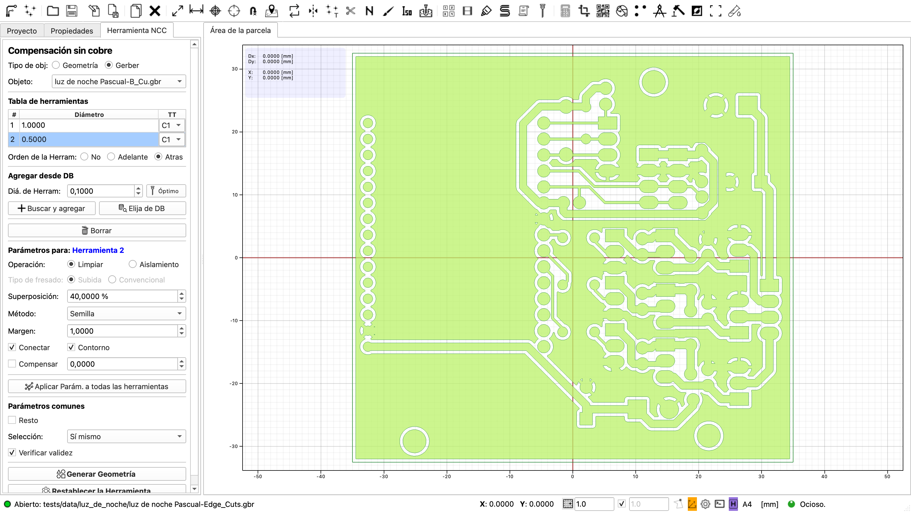
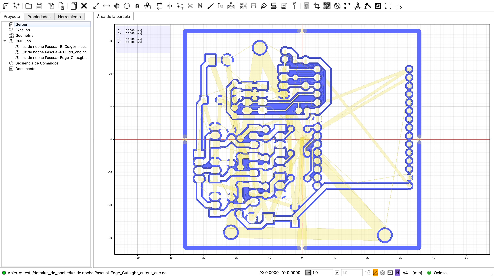

<p align="right"><a href="README.md">🇪🇸 Español</a> · <a href="README.en.md">🇬🇧 English</a> · <a href="README.de.md">🇩🇪 Deutsch</a> · <a href="README.fr.md">🇫🇷 Français</a> · <a href="README.it.md">🇮🇹 Italiano</a> · <a href="README.pt-BR.md">🇧🇷 Português</a> · <a href="README.ro.md">🇷🇴 Română</a> · <a href="README.ru.md">🇷🇺 Русский</a> · <a href="README.tr.md">🇹🇷 Türkçe</a></p>

<p align="center">
  
</p>

<h1 align="center">FlatCAM-cpp</h1>

<p align="center">
  Port nativ al <strong>FlatCAM 2024.4</strong> în C++17, Qt 6 și GEOS pentru realizarea plăcilor de circuit imprimat cu un CNC sau un laser.
</p>

<p align="center">
  <a href="https://github.com/dnasta/flatcam-cpp/releases/latest"></a>
  <a href="LICENSE"></a>
  <a href="https://github.com/dnasta/flatcam-cpp/actions/workflows/ci.yml"></a>
  
  
  
  
  
</p>

<p align="center">
  <a href="https://github.com/dnasta/flatcam-cpp/releases/latest"><strong>⬇ Descarcă v1.0.0</strong></a> ·
  <a href="docs/NOTAS_1.0.0.md"><strong>📝 Note de versiune (spaniolă)</strong></a> ·
  <a href="https://github.com/dnasta/flatcam-cpp/issues"><strong>🐞 Raportează o problemă</strong></a>
</p>

---

## Cuprins

- [Ce este FlatCAM-cpp](#ce-este-flatcam-cpp)
- [Capturi de ecran](#capturi-de-ecran)
- [Funcționalități](#funcționalități)
- [Limbi](#limbi)
- [Formate acceptate](#formate-acceptate)
- [Instalare](#instalare)
- [Pornire rapidă](#pornire-rapidă)
- [Linia de comandă și automatizare](#linia-de-comandă-și-automatizare)
- [Compilare din sursă](#compilare-din-sursă)
- [Teste și verificare](#teste-și-verificare)
- [Structura proiectului](#structura-proiectului)
- [Licență, autori și mulțumiri](#licență-autori-și-mulțumiri)

---

## Ce este FlatCAM-cpp

FlatCAM transformă fișierele de proiectare ale unei plăci —straturi **Gerber** și găuri **Excellon**— în **G-code** pentru o freză CNC, un router sau un laser: izolarea traseelor, îndepărtarea cuprului, găurire, decuparea plăcii și multe altele.

FlatCAM-cpp este un port **complet** al FlatCAM 2024.4 (Python + PyQt5) în **C++17**, cu **Qt 6** pentru interfață și **GEOS** pentru geometrie. Interfața este cea a originalului —a fost generată din interfața originală reală—, cu aceleași meniuri, panouri, scurtături și preferințe, și citește și scrie aceleași proiecte `.FlatPrj`.

**Pe scurt:** deschizi placa, alegi unealta, verifici traseele și salvezi G-code-ul.

### De ce un port nativ

| Aspect | FlatCAM 2024.4 (Python) | FlatCAM-cpp |
|---|---|---|
| Rulare | Python 3 + PyQt5 + Shapely + numpy + vispy | Executabil nativ |
| Instalare | Instalarea Python și a dependențelor | Programe de instalare pentru macOS, Windows și Linux |
| Geometrie | Shapely | GEOS (API C reentrant) |
| Interfață | Qt 5 | Qt 6 cu zonă de desen OpenGL |
| Viteză (îndepărtarea cuprului unei plăci reale) | 567 s | 56 s |
| Erori cunoscute ale originalului | Prezente | Peste 200 corectate (`--original-bugs` revine la comportamentul original) |

---

## Capturi de ecran

<p align="center">
  
  <br><em>Fereastra principală: cuprul unei plăci reale cu proprietățile sale (interfață în spaniolă).</em>
</p>

<p align="center">
  
  <br><em>Unealta de îndepărtare a cuprului (NCC).</em>
</p>

<p align="center">
  
  <br><em>G-code-ul îndepărtării cuprului, al găuririi și al decupării (deplasările în galben).</em>
</p>

<p align="center">
  
  <br><em>Aceeași interfață în germană, cu unealta de găurire.</em>
</p>

---

## Funcționalități

### Fișiere

- **Gerber RS-274X**: aperturi C/R/O/P, macro-uri `%AM`, regiuni `G36/G37`, arce `G02/G03`, polaritate și atribute X2.
- **Excellon**: unelte, găuri, fante (`G85` și rutare), formate și zerouri, fișiere fără antet.
- **G-code**: deschidere, vizualizare, editare și export.
- **SVG, DXF, PDF, HPGL2 și imagini** (PNG, JPG, BMP), ca Geometrie sau ca Gerber.
- **Proiecte `.FlatPrj`** din FlatCAM în Python (comprimate LZMA, chiar și de sute de MB); FlatCAM-ul original deschide proiectele salvate de port.
- **Export** în Gerber, Excellon, SVG, DXF, PNG și PDF.

### Unelte CAM

- **Izolare**: treceri, suprapunere, freze în V, combinată, prelucrarea restului, pe zonă sau pe poligon.
- **Îndepărtarea cuprului (NCC)** și **Pictare (Paint)**: metodele Standard, Sămânță, Linii și Combo, prelucrarea restului, zonă și obiect de referință; „linii laser”.
- **Găurire**: ordine optimizată, adâncime multiplă, fante ca găuri; frezarea găurilor și a fantelor.
- **Decupare**: liberă sau dreptunghiulară, punți, „mouse bites” și punți manuale.
- **PCB pe două fețe**: oglindire față de punct, cutie sau gaură, și găuri de aliniere.
- **Și în plus**: Panelizare, Film, Umplere cu cupru (thieving), Pastă de lipit, Cod QR, Repere (fiducials), Marcaje de colț, Extragere găuri, Perforare Gerber, Scădere, Optim, Verificarea regulilor, Calibrare, Compensarea corodării, Aliniere obiecte, Inversare Gerber, Calculatoare, Transformări, Distanță și Nivelare automată (palpare cu GRBL, MACH3/4 și LinuxCNC).
- **Baza de date a uneltelor** și **zone de excludere**.

### G-code

- Cele **20 de postprocesoare** ale originalului (`default`, `GRBL_laser`, `grbl_11`, `Marlin`, `Repetier`, `Roland_MDX_20`, `hpgl`, `ISEL_CNC`, `Toolchange_*`, `Z_laser`…), identice linie cu linie.
- Adâncime multiplă, tăiere suplimentară, cod de început și de sfârșit, milimetri sau țoli.

### Editoare

- **Geometrie** (cu texte scrise cu fonturile sistemului), **Excellon**, **Gerber** și **G-code**.

### Interfață

- Cea a FlatCAM 2024.4: meniuri, bare de unelte, filele Proiect / Proprietăți / Unealtă și aceleași scurtături.
- Zonă de desen OpenGL cu zoom, deplasare, grilă, aliniere la grilă, HUD și spațiu de lucru.
- Preferințe (485 de opțiuni), nivelurile De bază și Avansat, milimetri sau țoli, fișiere recente și marcaje.

### Automatizare

- **Consolă Tcl** cu interpretorul Tcl real și cele **65 de comenzi** ale originalului; scripturi `.tcl`.

---

## Limbi

Interfața este disponibilă în cele **9 limbi** ale originalului, cu aceleași traduceri: germană, engleză, spaniolă, franceză, italiană, portugheză braziliană, română, rusă și turcă.

- Pornește în **limba sistemului** (în engleză dacă aceasta nu este printre cele nouă).
- Pentru a o schimba: **Preferințe → General →** alegi limba **→ Aplica Traducere** (aplicația repornește).
- Pentru a impune una la pornire: variabila de mediu `FLATCAM_LANGUAGE` (de exemplu `FLATCAM_LANGUAGE=ro`).

---

## Formate acceptate

| Format | Deschidere / import | Export | Observații |
|---|:---:|:---:|---|
| Gerber RS-274X | ✅ | ✅ | Aperturi, macro-uri, regiuni, polaritate |
| Excellon | ✅ | ✅ | Găuri și fante |
| G-code | ✅ | ✅ | 20 de postprocesoare |
| SVG | ✅ | ✅ | Ca Geometrie sau Gerber |
| DXF | ✅ | ✅ | DXF ASCII |
| PDF | ✅ | ✅ | Import vectorial; tipărire și film |
| HPGL2 | ✅ | — | Postprocesorul `hpgl` generează cod pentru plottere |
| PNG / JPG / BMP | ✅ | ✅ | Vectorizare prin prag; captura zonei de desen și film |
| `.FlatPrj` | ✅ | ✅ | Compatibile cu FlatCAM în Python |

---

## Instalare

Programele de instalare se află pe pagina [**Releases**](https://github.com/dnasta/flatcam-cpp/releases/latest).

### macOS

- **macOS 15 sau mai nou**, cu **Apple Silicon** (M1 până la M4).
- Deschide `FlatCAM-1.0.0-macOS-arm64.dmg` și trage **FlatCAM** în *Aplicații*.
- Prima dată: clic dreapta → **Deschide** (semnătură ad hoc, nenotarizată).
- Include Qt, GEOS, FreeType și Tcl: nu este nevoie de Homebrew.

### Windows

- **Windows 10 (1809 sau mai nou) și Windows 11**, pe 64 de biți.
- `FlatCAM-1.0.0-Windows-x64-setup.exe` (program de instalare) sau `FlatCAM-1.0.0-Windows-x64.zip` (portabil, fără instalare).
- Dacă apare „Windows a protejat PC-ul”: **Mai multe informații → Rulează oricum** (nu este semnat cu un certificat).

### Linux

| Distribuție | Fișier | Instalare |
|---|---|---|
| Ubuntu 24.04+, Debian 13, Linux Mint 22 | `flatcam-cpp_1.0.0_amd64.deb` | `sudo apt install ./flatcam-cpp_1.0.0_amd64.deb` |
| Fedora 41+ | `flatcam-cpp-1.0.0-1.x86_64.rpm` | `sudo dnf install ./flatcam-cpp-1.0.0-1.x86_64.rpm` |
| Altele (glibc 2.39+) | `FlatCAM-1.0.0-Linux-x86_64.AppImage` | `chmod +x FlatCAM-*.AppImage && ./FlatCAM-*.AppImage` |

Cu `.deb` sau `.rpm`, FlatCAM apare în meniul de aplicații și pornește cu comanda `flatcam`.

---

## Pornire rapidă

```text
1. Fişiere → Încarcă → Încarcă Gerber      cuprul și conturul plăcii
   Fişiere → Încarcă → Încarcă Excellon    găurile
2. Alege cuprul în Proiect → Proprietati → Izolare (sau Unealta NCC)
   diametrul frezei, treceri și suprapunere → Genereza Geometrie
3. În noua Geometrie: Proprietati → Z de tăiere, avans → Generează un obiect CNCJob
4. În CNC Job: Salvează codul CNC
5. Găuri: Unealtă Găurire → Generează un obiect CNCJob
6. Contur: Unealta Decupare → punți → Genereza Geometrie
```

> **Înainte de prelucrare:** verifică G-code-ul, originea piesei și înălțimea Z. O greșeală de 0,1 mm poate strica placa.

---

## Linia de comandă și automatizare

```bash
FlatCAM placa-B_Cu.gbr placa-Edge_Cuts.gbr placa.drl   # deschide fișierele (după extensie)
FlatCAM proiect.FlatPrj                                 # deschide un proiect
FlatCAM script.tcl                                      # deschide și rulează un script Tcl
FlatCAM --original-bugs                                 # se comportă exact ca FlatCAM-ul original
```

Executabilul este `FlatCAM` (pe macOS, `/Applications/FlatCAM.app/Contents/MacOS/FlatCAM`), `FlatCAM.exe` pe Windows și `flatcam` pe Linux.

### Consola Tcl

Se deschide cu **Linie de comanda** (tasta `S`). Exemplu:

```tcl
open_gerber placa-B_Cu.gbr -outname cupru
isolate cupru -dia 0.2 -passes 2 -overlap 10 -combine True -outname cupru_iso
cncjob cupru_iso -dia 0.2 -z_cut -0.1 -z_move 2 -feedrate 120 -pp default -outname cupru_cnc
write_gcode cupru_cnc cupru.nc

open_excellon placa.drl -outname gauri
drillcncjob gauri -drillz -1.8 -travelz 2 -feedrate_z 100 -pp default -outname gauri_cnc
write_gcode gauri_cnc gauri.nc
```

`help` listează cele 65 de comenzi, iar `help <comandă>` o explică pe fiecare.

---

## Compilare din sursă

| Dependență | Utilizare |
|---|---|
| Compilator C++17 și CMake 3.20+ | AppleClang, GCC sau MSVC 2022 |
| GEOS 3.11+ | Geometrie |
| Qt 6.4+ | Interfață (Widgets, OpenGLWidgets, Svg, PrintSupport; SerialPort opțional) |
| Tcl 8.6 sau 9 | Consola Tcl |
| liblzma | Proiecte `.FlatPrj` comprimate |
| FreeType (opțional) | Texte cu fonturi în editorul de Geometrie |
| GoogleTest | Teste (CMake îl descarcă dacă lipsește) |

**macOS (Homebrew)**

```zsh
brew install cmake ninja geos qt tcl-tk freetype xz googletest
cmake -S . -B build -G Ninja
cmake --build build
ctest --test-dir build --output-on-failure
open build/src/gui/FlatCAM.app
tools/package_macos.sh            # build/dist/FlatCAM-1.0.0-macOS-arm64.dmg
```

**Linux (Ubuntu / Debian)**

```bash
sudo apt install build-essential cmake ninja-build libgeos-dev liblzma-dev libgtest-dev \
  qt6-base-dev qt6-svg-dev qt6-serialport-dev libgl-dev tcl-dev libfreetype-dev
cmake -S . -B build -G Ninja -DCMAKE_BUILD_TYPE=Release
cmake --build build
ctest --test-dir build --output-on-failure
tools/package_linux.sh            # .deb și AppImage (pe Fedora: .rpm)
```

**Windows (Visual Studio 2022 + vcpkg + Qt)**

```bat
vcpkg install geos liblzma freetype gtest tcl --triplet x64-windows
cmake -S . -B build -G Ninja -DCMAKE_BUILD_TYPE=Release -DCMAKE_TOOLCHAIN_FILE=%VCPKG_ROOT%\scripts\buildsystems\vcpkg.cmake
cmake --build build
ctest --test-dir build --output-on-failure
pwsh tools/package_windows.ps1    # program de instalare (Inno Setup) și .zip
```

Opțiuni CMake: `-DFLATCAM_BUILD_TESTS=OFF`, `-DFLATCAM_BUILD_DOCS=OFF`, `-DFLATCAM_BUILD_GUI=OFF` (doar nucleul).

**Documentația codului** (Doxygen, în spaniolă): `cmake --build build --target docs` → `build/doxygen/html/index.html`.

---

## Teste și verificare

- **2.854 de teste** (GoogleTest): nucleu și interfață. Rulează în CI (GitHub Actions) pe Linux și Windows, și cu două versiuni de GEOS.
- Valorile așteptate **nu au fost scrise de mână**: oracolele din `tests/tools/` rulează codul **original** al FlatCAM (analizoare, unelte, postprocesoare, editoare, consola Tcl și interfața PyQt5) și îi salvează rezultatele.
- Față de **executabilul FlatCAM 2024.4** cu o placă reală: decuparea iese **identică octet cu octet**, Paint și NCC cu aceleași trasee, iar găurirea cu aceleași găuri.
- Erorile originalului sunt corectate în aplicație; testele le reactivează pentru a compara în continuare cu originalul, iar fiecare corectură are propriul test.

---

## Structura proiectului

```text
src/core/        Nucleu fără Qt: forme (GEOS), geometrie, arce, transformări
src/parsers/     Gerber, Excellon, SVG, DXF, PDF, HPGL2, imagini și fonturi
src/tools/       Unelte CAM (izolare, NCC, Paint, decupare, două fețe, panelizare, film...)
src/cam/         G-code, postprocesoare, ordinea găurilor, nivelare
src/editors/     Modelele editoarelor (fără Qt)
src/io/          Proiecte .FlatPrj și export
src/gui/         Interfața Qt 6 (generated/: generată din interfața originală)
tests/           GoogleTest, date reale și oracole în Python
tools/           Generatoare pentru interfață, traduceri și pachete
reference/       Sursele FlatCAM 2024.4 (doar citire)
```

---

## Licență, autori și mulțumiri

FlatCAM-cpp este distribuit sub **licența MIT**, la fel ca FlatCAM. Vezi [`LICENSE`](LICENSE) și [`NOTICE`](NOTICE).

Este portul unui șir de versiuni FlatCAM:

1. **FlatCAM**, creat de **Juan Pablo Caram** (2014–2016). <http://flatcam.org>
2. **FlatCAM Beta** (8.9xx și 2024.x), de **Marius Adrian Stanciu** și colaboratori (2019–2024).
3. **FlatCAM β 2024.4**, întreținut de **vika-sonne** (2023–2024).
4. **FlatCAM-cpp**: portul în C++17 cu Qt 6 și GEOS.

**Mulțumiri:** autorilor FlatCAM și traducătorilor săi; [GEOS](https://libgeos.org) (OSGeo); [Qt](https://www.qt.io) (The Qt Company); [Tcl](https://www.tcl-lang.org); [FreeType](https://freetype.org); bibliotecii [qrcode](https://github.com/lincolnloop/python-qrcode) a Lincoln Loop (portată în C++).

<p align="center"><sub>C++17 · Qt 6 · GEOS · macOS · Windows · Linux · v1.0.0</sub></p>
