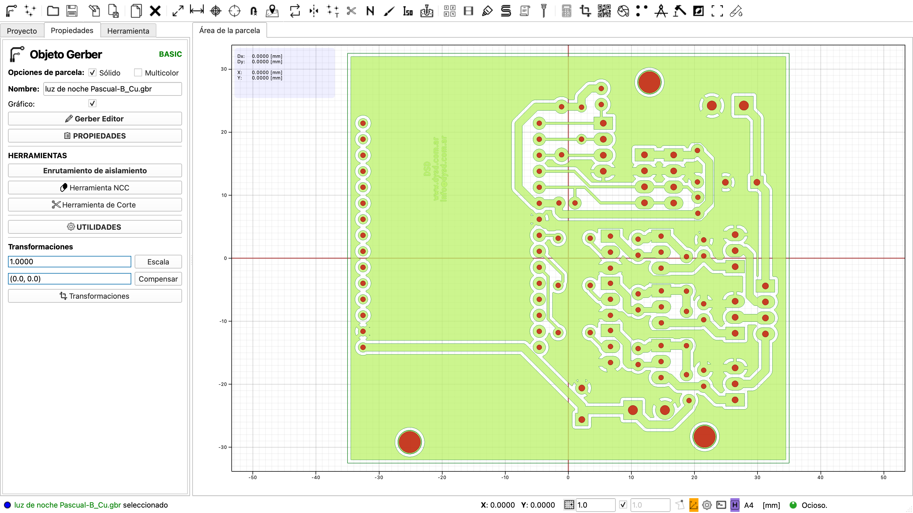

<p align="right"><a href="README.md">🇪🇸 Español</a> · <a href="README.en.md">🇬🇧 English</a> · <a href="README.de.md">🇩🇪 Deutsch</a> · <a href="README.fr.md">🇫🇷 Français</a> · <a href="README.it.md">🇮🇹 Italiano</a> · <a href="README.pt-BR.md">🇧🇷 Português</a> · <a href="README.ro.md">🇷🇴 Română</a> · <a href="README.ru.md">🇷🇺 Русский</a> · <a href="README.tr.md">🇹🇷 Türkçe</a></p>

<p align="center">
  
</p>

<h1 align="center">FlatCAM-cpp</h1>

<p align="center">
  Нативный порт <strong>FlatCAM 2024.4</strong> на C++17, Qt 6 и GEOS для изготовления печатных плат на станке с ЧПУ или лазером.
</p>

<p align="center">
  <a href="https://github.com/dnasta/flatcam-cpp/releases/latest"></a>
  <a href="LICENSE"></a>
  <a href="https://github.com/dnasta/flatcam-cpp/actions/workflows/ci.yml"></a>
  
  
  
  
  
</p>

<p align="center">
  <a href="https://github.com/dnasta/flatcam-cpp/releases/latest"><strong>⬇ Скачать v1.0.0</strong></a> ·
  <a href="docs/NOTAS_1.0.0.md"><strong>📝 Примечания к выпуску (на испанском)</strong></a> ·
  <a href="https://github.com/dnasta/flatcam-cpp/issues"><strong>🐞 Сообщить о проблеме</strong></a>
</p>

---

## Содержание

- [Что такое FlatCAM-cpp](#что-такое-flatcam-cpp)
- [Снимки экрана](#снимки-экрана)
- [Возможности](#возможности)
- [Языки](#языки)
- [Поддерживаемые форматы](#поддерживаемые-форматы)
- [Установка](#установка)
- [Быстрый старт](#быстрый-старт)
- [Командная строка и автоматизация](#командная-строка-и-автоматизация)
- [Сборка из исходного кода](#сборка-из-исходного-кода)
- [Тесты и проверка](#тесты-и-проверка)
- [Структура проекта](#структура-проекта)
- [Лицензия, авторство и благодарности](#лицензия-авторство-и-благодарности)

---

## Что такое FlatCAM-cpp

FlatCAM превращает файлы проекта печатной платы —слои **Gerber** и сверловку **Excellon**— в **G-code** для фрезерного станка с ЧПУ, гравера или лазера: изоляция дорожек, удаление меди, сверление, вырезка платы и многое другое.

FlatCAM-cpp — это **полный** порт FlatCAM 2024.4 (Python + PyQt5) на **C++17**: **Qt 6** для интерфейса и **GEOS** для геометрии. Интерфейс такой же, как у оригинала —он сгенерирован из настоящего оригинального интерфейса—, с теми же меню, панелями, горячими клавишами и настройками; программа читает и записывает те же проекты `.FlatPrj`.

**Одной фразой:** открываете плату, выбираете инструмент, проверяете траектории и сохраняете G-code.

### Зачем нативный порт

| Параметр | FlatCAM 2024.4 (Python) | FlatCAM-cpp |
|---|---|---|
| Запуск | Python 3 + PyQt5 + Shapely + numpy + vispy | Нативный исполняемый файл |
| Установка | Установить Python и его зависимости | Установщики для macOS, Windows и Linux |
| Геометрия | Shapely | GEOS (реентерабельный C API) |
| Интерфейс | Qt 5 | Qt 6 с холстом OpenGL |
| Скорость (удаление меди на реальной плате) | 567 с | 56 с |
| Известные ошибки оригинала | Есть | Более 200 исправлено (`--original-bugs` возвращает исходное поведение) |

---

## Снимки экрана

<p align="center">
  
  <br><em>Главное окно: медь реальной платы и её свойства (интерфейс на испанском).</em>
</p>

<p align="center">
  
  <br><em>Инструмент удаления меди (NCC).</em>
</p>

<p align="center">
  
  <br><em>G-code удаления меди, сверления и вырезки (холостые перемещения — жёлтым).</em>
</p>

<p align="center">
  
  <br><em>Тот же интерфейс на немецком, с инструментом сверления.</em>
</p>

---

## Возможности

### Файлы

- **Gerber RS-274X**: апертуры C/R/O/P, макросы `%AM`, области `G36/G37`, дуги `G02/G03`, полярность и атрибуты X2.
- **Excellon**: инструменты, отверстия, пазы (`G85` и фрезеровка), форматы и нули, файлы без заголовка.
- **G-code**: открытие, просмотр, редактирование и экспорт.
- **SVG, DXF, PDF, HPGL2 и изображения** (PNG, JPG, BMP) — как Геометрия или как Gerber.
- **Проекты `.FlatPrj`** из FlatCAM на Python (сжатые LZMA, в том числе на сотни МБ); оригинальный FlatCAM открывает проекты, сохранённые портом.
- **Экспорт** в Gerber, Excellon, SVG, DXF, PNG и PDF.

### Инструменты CAM

- **Изоляция**: проходы, перекрытие, V-образные фрезы, комбинированная, доработка остатка, по области или по полигону.
- **Удаление меди (NCC)** и **Заливка (Paint)**: методы Стандартный, Затравка, Линии и Комбинированный, доработка остатка, область и опорный объект; «лазерные линии».
- **Сверление**: оптимизированный порядок, многопроходная глубина, пазы как отверстия; фрезеровка отверстий и пазов.
- **Вырезка**: произвольная или прямоугольная, перемычки, «mouse bites» и ручные перемычки.
- **Двусторонняя плата**: зеркалирование относительно точки, рамки или отверстия, отверстия для совмещения.
- **А также**: Панелизация, Плёнка, Заполнение медью (thieving), Паяльная паста, QR-код, Реперные знаки, Угловые метки, Извлечение отверстий, Пробивка Gerber, Вычитание, Оптимальный, Проверка правил, Калибровка, Компенсация травления, Выравнивание объектов, Инверсия Gerber, Калькуляторы, Преобразования, Расстояние и Автовыравнивание (зондирование с GRBL, MACH3/4 и LinuxCNC).
- **База данных инструментов** и **зоны исключения**.

### G-code

- **20 постпроцессоров** оригинала (`default`, `GRBL_laser`, `grbl_11`, `Marlin`, `Repetier`, `Roland_MDX_20`, `hpgl`, `ISEL_CNC`, `Toolchange_*`, `Z_laser`…), построчно идентичные.
- Многопроходная глубина, дополнительный рез, начальный и конечный код, миллиметры или дюймы.

### Редакторы

- **Геометрия** (с текстом системными шрифтами), **Excellon**, **Gerber** и **G-code**.

### Интерфейс

- Как у FlatCAM 2024.4: меню, панели инструментов, вкладки Проект / Свойства / Инструмент и те же горячие клавиши.
- Холст OpenGL с масштабированием, панорамированием, сеткой, привязкой к сетке, HUD и рабочей областью.
- Настройки (485 параметров), уровни Базовый и Расширенный, миллиметры или дюймы, недавние файлы и закладки.

### Автоматизация

- **Консоль Tcl** с настоящим интерпретатором Tcl и **65 командами** оригинала; скрипты `.tcl`.

---

## Языки

Интерфейс доступен на **9 языках** оригинала, с теми же переводами: немецком, английском, испанском, французском, итальянском, бразильском португальском, румынском, русском и турецком.

- Программа запускается на **языке системы** (на английском, если его нет среди девяти).
- Чтобы сменить язык: **Настройки → Основные →** выбрать язык **→ Применить** (приложение перезапустится).
- Чтобы задать язык при запуске: переменная окружения `FLATCAM_LANGUAGE` (например, `FLATCAM_LANGUAGE=ru`).

---

## Поддерживаемые форматы

| Формат | Открытие / импорт | Экспорт | Примечания |
|---|:---:|:---:|---|
| Gerber RS-274X | ✅ | ✅ | Апертуры, макросы, области, полярность |
| Excellon | ✅ | ✅ | Отверстия и пазы |
| G-code | ✅ | ✅ | 20 постпроцессоров |
| SVG | ✅ | ✅ | Как Геометрия или Gerber |
| DXF | ✅ | ✅ | ASCII DXF |
| PDF | ✅ | ✅ | Векторный импорт; печать и плёнка |
| HPGL2 | ✅ | — | Постпроцессор `hpgl` создаёт код для плоттеров |
| PNG / JPG / BMP | ✅ | ✅ | Векторизация по порогу; снимок холста и плёнка |
| `.FlatPrj` | ✅ | ✅ | Совместимы с FlatCAM на Python |

---

## Установка

Установщики находятся на странице [**Releases**](https://github.com/dnasta/flatcam-cpp/releases/latest).

### macOS

- **macOS 15 или новее**, на **Apple Silicon** (M1–M4).
- Откройте `FlatCAM-1.0.0-macOS-arm64.dmg` и перетащите **FlatCAM** в *Программы*.
- В первый раз: правый щелчок → **Открыть** (подпись ad hoc, без нотаризации).
- Qt, GEOS, FreeType и Tcl уже внутри: Homebrew не нужен.

### Windows

- **Windows 10 (1809 или новее) и Windows 11**, 64-разрядные.
- `FlatCAM-1.0.0-Windows-x64-setup.exe` (установщик) или `FlatCAM-1.0.0-Windows-x64.zip` (портативная версия, без установки).
- Если появится «Windows защитила ваш компьютер»: **Подробнее → Выполнить в любом случае** (программа не подписана сертификатом).

### Linux

| Дистрибутив | Файл | Установка |
|---|---|---|
| Ubuntu 24.04+, Debian 13, Linux Mint 22 | `flatcam-cpp_1.0.0_amd64.deb` | `sudo apt install ./flatcam-cpp_1.0.0_amd64.deb` |
| Fedora 41+ | `flatcam-cpp-1.0.0-1.x86_64.rpm` | `sudo dnf install ./flatcam-cpp-1.0.0-1.x86_64.rpm` |
| Другие (glibc 2.39+) | `FlatCAM-1.0.0-Linux-x86_64.AppImage` | `chmod +x FlatCAM-*.AppImage && ./FlatCAM-*.AppImage` |

После установки `.deb` или `.rpm` FlatCAM появляется в меню приложений и запускается командой `flatcam`.

---

## Быстрый старт

```text
1. Файл → Открыть → Открыть Gerber      медь и контур платы
   Файл → Открыть → Открыть Excellon    отверстия
2. Выберите медь в Проект → Свойства → Изоляция разводки (или Очистка меди)
   диаметр фрезы, проходы и перекрытие → Создать объект
3. В новой Геометрии: Свойства → Z резания, подача → Создать объект CNCJob
4. В CNC Job: Сохранить CNC Code
5. Отверстия: буровой инструмент → Создать объект CNCJob
6. Контур: Обрезка платы → перемычки → Создать объект
```

> **Перед обработкой:** проверьте G-code, ноль заготовки и высоту Z. Ошибка в 0,1 мм может испортить плату.

---

## Командная строка и автоматизация

```bash
FlatCAM plata-B_Cu.gbr plata-Edge_Cuts.gbr plata.drl   # открывает файлы (по расширению)
FlatCAM proekt.FlatPrj                                  # открывает проект
FlatCAM script.tcl                                      # открывает и выполняет скрипт Tcl
FlatCAM --original-bugs                                 # ведёт себя точно как оригинальный FlatCAM
```

Исполняемый файл — `FlatCAM` (в macOS `/Applications/FlatCAM.app/Contents/MacOS/FlatCAM`), `FlatCAM.exe` в Windows и `flatcam` в Linux.

### Консоль Tcl

Открывается через **Командная строка** (клавиша `S`). Пример:

```tcl
open_gerber plata-B_Cu.gbr -outname med
isolate med -dia 0.2 -passes 2 -overlap 10 -combine True -outname med_iso
cncjob med_iso -dia 0.2 -z_cut -0.1 -z_move 2 -feedrate 120 -pp default -outname med_cnc
write_gcode med_cnc med.nc

open_excellon plata.drl -outname otverstiya
drillcncjob otverstiya -drillz -1.8 -travelz 2 -feedrate_z 100 -pp default -outname otverstiya_cnc
write_gcode otverstiya_cnc otverstiya.nc
```

`help` выводит список 65 команд, а `help <команда>` объясняет каждую.

---

## Сборка из исходного кода

| Зависимость | Назначение |
|---|---|
| Компилятор C++17 и CMake 3.20+ | AppleClang, GCC или MSVC 2022 |
| GEOS 3.11+ | Геометрия |
| Qt 6.4+ | Интерфейс (Widgets, OpenGLWidgets, Svg, PrintSupport; SerialPort — по желанию) |
| Tcl 8.6 или 9 | Консоль Tcl |
| liblzma | Сжатые проекты `.FlatPrj` |
| FreeType (по желанию) | Текст шрифтами в редакторе Геометрии |
| GoogleTest | Тесты (CMake скачает, если его нет) |

**macOS (Homebrew)**

```zsh
brew install cmake ninja geos qt tcl-tk freetype xz googletest
cmake -S . -B build -G Ninja
cmake --build build
ctest --test-dir build --output-on-failure
open build/src/gui/FlatCAM.app
tools/package_macos.sh            # build/dist/FlatCAM-1.0.0-macOS-arm64.dmg
```

**Linux (Ubuntu / Debian)**

```bash
sudo apt install build-essential cmake ninja-build libgeos-dev liblzma-dev libgtest-dev \
  qt6-base-dev qt6-svg-dev qt6-serialport-dev libgl-dev tcl-dev libfreetype-dev
cmake -S . -B build -G Ninja -DCMAKE_BUILD_TYPE=Release
cmake --build build
ctest --test-dir build --output-on-failure
tools/package_linux.sh            # .deb и AppImage (в Fedora: .rpm)
```

**Windows (Visual Studio 2022 + vcpkg + Qt)**

```bat
vcpkg install geos liblzma freetype gtest tcl --triplet x64-windows
cmake -S . -B build -G Ninja -DCMAKE_BUILD_TYPE=Release -DCMAKE_TOOLCHAIN_FILE=%VCPKG_ROOT%\scripts\buildsystems\vcpkg.cmake
cmake --build build
ctest --test-dir build --output-on-failure
pwsh tools/package_windows.ps1    # установщик (Inno Setup) и .zip
```

Параметры CMake: `-DFLATCAM_BUILD_TESTS=OFF`, `-DFLATCAM_BUILD_DOCS=OFF`, `-DFLATCAM_BUILD_GUI=OFF` (только ядро).

**Документация кода** (Doxygen, на испанском): `cmake --build build --target docs` → `build/doxygen/html/index.html`.

---

## Тесты и проверка

- **2854 теста** (GoogleTest): ядро и интерфейс. Они выполняются в CI (GitHub Actions) на Linux и Windows и с двумя версиями GEOS.
- Ожидаемые значения **не написаны вручную**: оракулы из `tests/tools/` запускают **оригинальный** код FlatCAM (парсеры, инструменты, постпроцессоры, редакторы, консоль Tcl и интерфейс PyQt5) и сохраняют его результаты.
- В сравнении с **исполняемым файлом FlatCAM 2024.4** на реальной плате: вырезка совпадает **байт в байт**, Paint и NCC дают те же траектории, а сверление — те же отверстия.
- Ошибки оригинала в приложении исправлены; тесты включают их снова, чтобы продолжать сравнение с оригиналом, и у каждого исправления есть свой тест.

---

## Структура проекта

```text
src/core/        Ядро без Qt: фигуры (GEOS), геометрия, дуги, преобразования
src/parsers/     Gerber, Excellon, SVG, DXF, PDF, HPGL2, изображения и шрифты
src/tools/       Инструменты CAM (изоляция, NCC, Paint, вырезка, двусторонняя, панелизация, плёнка...)
src/cam/         G-code, постпроцессоры, порядок отверстий, автовыравнивание
src/editors/     Модели редакторов (без Qt)
src/io/          Проекты .FlatPrj и экспорт
src/gui/         Интерфейс Qt 6 (generated/: сгенерирован из оригинального интерфейса)
tests/           GoogleTest, реальные данные и оракулы на Python
tools/           Генераторы интерфейса, переводов и пакетов
reference/       Исходники FlatCAM 2024.4 (только чтение)
```

---

## Лицензия, авторство и благодарности

FlatCAM-cpp распространяется по **лицензии MIT**, как и FlatCAM. См. [`LICENSE`](LICENSE) и [`NOTICE`](NOTICE).

Это порт целой линии версий FlatCAM:

1. **FlatCAM**, созданный **Juan Pablo Caram** (2014–2016). <http://flatcam.org>
2. **FlatCAM Beta** (8.9xx и 2024.x) от **Marius Adrian Stanciu** и участников (2019–2024).
3. **FlatCAM β 2024.4**, сопровождаемый **vika-sonne** (2023–2024).
4. **FlatCAM-cpp**: порт на C++17 с Qt 6 и GEOS.

**Благодарности:** авторам FlatCAM и его переводчикам; [GEOS](https://libgeos.org) (OSGeo); [Qt](https://www.qt.io) (The Qt Company); [Tcl](https://www.tcl-lang.org); [FreeType](https://freetype.org); библиотеке [qrcode](https://github.com/lincolnloop/python-qrcode) от Lincoln Loop (портирована на C++).

<p align="center"><sub>C++17 · Qt 6 · GEOS · macOS · Windows · Linux · v1.0.0</sub></p>
